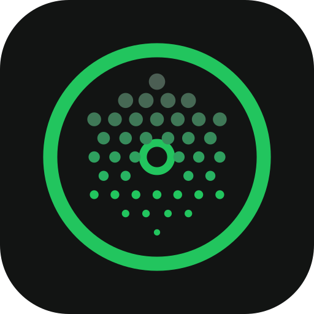
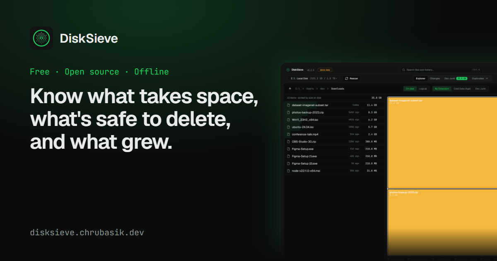

<div align="center">



# DiskSieve website

**The landing page of [DiskSieve](https://github.com/DiskSieve/disksieve), a fast, offline disk space analyzer for developers and power users.**

[**disksieve.chrubasik.dev**](https://disksieve.chrubasik.dev) · [Live demo](https://disksieve.chrubasik.dev/demo/) · [Download the app](https://github.com/DiskSieve/disksieve/releases/latest)

[](https://github.com/DiskSieve/website/actions/workflows/ci.yml)
[](https://github.com/DiskSieve/website/actions/workflows/deploy.yml)


<br />



</div>

---

## Table of contents

- [What's on the site](#whats-on-the-site)
- [Fast, private, accessible](#fast-private-accessible)
- [Ready for search engines and AI agents](#ready-for-search-engines-and-ai-agents)
- [Live demo](#live-demo)
- [Getting started](#getting-started)
- [Project structure](#project-structure)
- [Deployment](#deployment)
- [License](#license)

## What's on the site

One static page, built from a single content file (`src/content/site.ts`):

- **Hero** with a download button that detects your system and links the right installer from the latest GitHub release
- **Why DiskSieve:** what takes space, what is safe to delete and what grew since the last scan
- **Features** with screenshots of the real app
- **Comparison** with other disk space analyzers
- **Privacy and safety:** offline, no telemetry, Move to Trash only
- **Download** for Windows, macOS and Linux, with file sizes and `SHA256SUMS.txt`
- **Roadmap** and **FAQ**

Release data (version, files, sizes) comes from the GitHub API at runtime and is cached for an hour. If GitHub is unreachable, the buttons fall back to the releases page.

## Fast, private, accessible

|                        |                                                                                                                         |
| :--------------------- | :---------------------------------------------------------------------------------------------------------------------- |
| **PageSpeed (mobile)** | 100 Performance · 100 Accessibility · 100 Best Practices · 100 SEO                                                      |
| **Weight**             | ~163 KB on first load, CSS inlined, headline font preloaded                                                             |
| **Privacy**            | No analytics, no cookies, no third-party scripts or fonts. The only outside request is the GitHub API for release data. |
| **Security**           | Strict Content Security Policy with hashed inline scripts, `form-action 'none'`, no `unsafe-eval`                       |
| **Accessibility**      | Skip link, semantic landmarks, visible focus, `prefers-reduced-motion` respected, works without JavaScript              |

## Ready for search engines and AI agents

- **Search and sharing:** canonical URL, Open Graph and Twitter cards (`og.png`, 1200×630), `sitemap.xml`, `robots.txt`
- **Structured data:** JSON-LD with `WebSite`, `SoftwareApplication` and `FAQPage`
- **[`/llms.txt`](https://disksieve.chrubasik.dev/llms.txt):** a Markdown summary of DiskSieve for AI assistants
- **[ARD manifest](https://disksieve.chrubasik.dev/.well-known/ard.json):** Agentic Resource Discovery at `/.well-known/ard.json`, linked from `robots.txt` (`Agentmap:`) and `<link rel="ard">`
- **[WebMCP](https://developer.chrome.com/docs/ai/webmcp) tools** for agents in Chrome (origin trial): `get_disksieve_overview`, `get_download_links`, `search_faq` and `open_live_demo`

## Live demo

[`/demo/`](https://disksieve.chrubasik.dev/demo/) is the real DiskSieve interface running in the browser with example data. It cannot scan the visitor's disk.

CI checks out the app at its latest release tag and builds its frontend under `/demo/` (`scripts/demo.mjs`). The demo gets its own CSP, `noindex` and a notice for small screens. The app repository is never modified.

To build it locally (from the app's default branch), run:

```sh
npm run build
git clone --depth 1 https://github.com/DiskSieve/disksieve .demo-app
node scripts/demo.mjs .demo-app
```

## Getting started

Requires Node.js 22.23.4 or newer.

```sh
npm install
npm run dev      # dev server at http://localhost:4321
npm run check    # Astro and TypeScript checks
npm run lint     # ESLint and Prettier check
npm run format   # format with Prettier
npm run build    # static site in dist/
npm run preview  # serve the built site
```

## Project structure

```text
├── public/                  # favicon, og.png, CNAME
├── scripts/
│   ├── demo.mjs             # builds the app's frontend into dist/demo/
│   └── demo-notice.js       # "works best on a larger screen" notice for the demo
└── src/
    ├── assets/              # logo and app screenshots
    ├── components/          # Hero, Why, Features, Comparison, Privacy, Download, Roadmap, Faq
    ├── content/
    │   ├── site.ts          # all copy, links and download targets
    │   ├── seo.ts           # JSON-LD, llms.txt, OG image, WebMCP origin trial token
    │   └── ard.ts           # ARD manifest
    ├── layouts/Base.astro   # head, header, footer
    ├── pages/               # index, llms.txt, robots.txt, sitemap.xml, .well-known/
    ├── scripts/             # download buttons, release lookup, reveal animations, WebMCP
    └── styles/global.css    # design tokens (dark, emerald #22C55E)
```

## Deployment

Every push to `main` builds the site and the live demo and deploys them to GitHub Pages at the custom domain `disksieve.chrubasik.dev`. Pull requests run the same checks in CI.

After a new app release, run **Deploy to GitHub Pages** by hand to refresh the demo.

## License

The DiskSieve app is MIT-licensed. This website, the DiskSieve logo and branding are © DiskSieve, all rights reserved.
